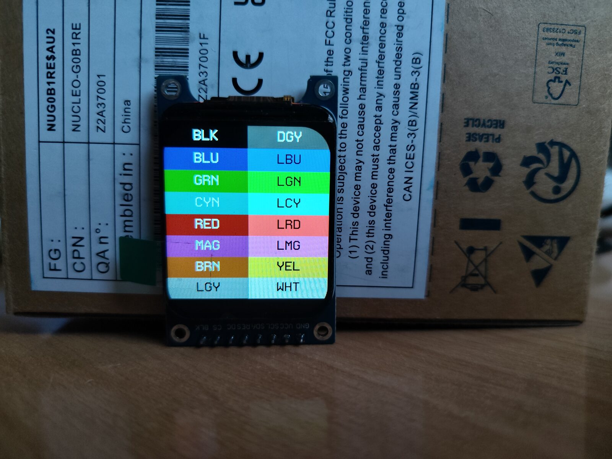

# u8g2 and mui for MicroPython

[u8g2](https://github.com/olikraus/u8g2) graphics and [mui](https://github.com/olikraus/u8g2/wiki/muimanual) menus for MicroPython, on low-cost color displays: ST7789, ILI9341 and GC9A01.

The goal is to use low-cost, easily sourced commodity displays on microcontrollers with little ram.

My use case is: you have an embedded system, a cheap smartwatch display, and lvgl uses all ram and cpu. This is an alternative.

Simply stated: I want ram to go to the application, not the graphics.

u8g2 stays monochrome.
The display driver adds the color.
u8g2 fonts, drawing and mui menus work unchanged.
Each 8 pixel x 8 pixel tile gets one of 16 foreground/background color pairs.
Setting color per 8x8 pixel tile is sufficient for user interfaces, but not for photos.
Compared to classic full color framebuffers, the advantage is memory.

16 foreground/background color pairs form the **color look-up table** (CLUT).
The **tile map** holds one 4-bit clut index for each 8×8 tile.
In a tile, set pixels get the foreground color of the tile clut entry, clear pixels get the background color.
At start, the palette is the standard 16-color VGA palette, and every tile uses entry 0, white on black.
Changing a clut entry recolors every tile that uses it, at the next display update, without redrawing.

On the round 240×240 GC9A01 of the Sunton ESP32-2424S012:

| | bytes |
|---|---|
| u8g2 buffer, 1 bit per pixel | 7200 byte |
| tile map, 4 bits per tile | 450 byte |
| clut, 16 color pairs | 64 byte |
| **total** | **7.7 kbyte** |

For comparison: full 16-bit framebuffer: 112 kbyte.

Measured on the Sunton, MicroPython heap before and after `import display`:

```
>>> import gc
>>> gc.collect(); gc.mem_free()
177584
>>> import display
>>> gc.collect(); gc.mem_free()
169200
```

`import display` uses 8384 bytes: the buffer and tile map above, plus the SPI and Pin objects of `display.py`.

## demos

Basic u8g2 graphics on a Sunton ESP32-2424S012 (ESP32-C3, GC9A01):

https://github.com/user-attachments/assets/acd87570-4d14-4972-b3e6-b9285be7a90a

[source](https://github.com/koendv/u8g2/blob/clut/sys/micropython/examples/demo_graphics.py)

A mui form is a string. Python is good with strings, so mui and MicroPython go together naturally.

https://github.com/user-attachments/assets/bd9a7714-c99a-427c-8cd7-3b753207e989

[source](https://github.com/koendv/u8g2/blob/clut/sys/micropython/examples/demo_mui.py)

## firmware for the Sunton ESP32-2424S012

ESP32-C3, round 240×240 GC9A01 display, CST816 touch.
Download firmware from [releases](https://github.com/koendv/micropython-u8g2/releases). Flash over USB:

```
pip install esptool
python -m esptool --chip esp32c3 --port /dev/ttyACM0 write_flash 0 ESP32_SUNTON_2424S012.bin
```

On Windows use `COMn`.

Connect with [mpremote](https://docs.micropython.org/en/latest/reference/mpremote.html) or [Thonny](https://thonny.org/). Verification: MicroPython prompt `>>>`.

Run a demo

```
import demo_graphics
demo_graphics.run()
```

Verification: graphics appear on the display. ctrl-c to stop. Other demos:

| demo | |
|---|---|
| `demo_graphics.run()` | boxes, circles, lines, text, bitmaps |
| `demo_clock.run()` | analog clock |
| `demo_mui.run_keys()` | arrow keys or wasd, space, enter, q |
| `demo_mui.run_touch()` | tap the edges and the center of the screen |
| `demo_settings.run_keys()` | a settings menu |
| `demo_touch.run()` | a dot following your finger |

When writing a script, begin with:

```
import u8g2
import display
import touch
```

Additions to standard u8g2:

```
u8g2.set_clut_color(idx, fg, bg)          # idx 0..15, fg/bg 0xRRGGBB
u8g2.set_clut_region(tx, ty, tw, th, idx) # in tiles of 8x8 pixels
u8g2.get_clut_map_size()                  # bytes
u8g2.load_clut_map(buf)                   # complete map, get_clut_map_size() bytes
u8g2.write_buffer_ppm(file)               # screen in color, plain ppm
u8g2.screenshot(file=None)                # ppm on a color display, pbm otherwise. output to serial if no file given.
```

Example:

```
u8g2.set_clut_color(1, 0xFFFFFF, 0x0000FF)  # entry 1: white on blue
u8g2.set_clut_region(0, 0, 30, 4, 1)        # top 32 pixel rows use entry 1
u8g2.send_buffer()
```

The tile map is allocated by `u8g2.init()`. A changed color shows at the next `send_buffer()`, or `update_display_area()` for part of the screen.

If MicroPython prints "The filesystem appears to be corrupted", erase the filesystem area and reset:

```
python -m esptool --chip esp32c3 --port /dev/ttyACM0 erase_region 0x200000 0x200000
```

## other boards

- Waveshare ESP32-S3-Touch-LCD-1.69 (ESP32-S3, ST7789 240×280, CST816 touch). Flash with:

```
python -m esptool --chip esp32s3 --port /dev/ttyACM0 write_flash 0 WAVESHARE_ESP32_S3_TOUCH_LCD_1_69.bin
```

- WeAct mini STM32U585 with a 240×280 ST7789.
[Wiring and dfu mode](https://github.com/koendv/u8g2/tree/clut/sys/micropython#readme).
Flash with:

```
dfu-util -d 0483:df11 -a 0 -s 0x08000000:leave -D WEACTSTUDIO_MINI_STM32U585.dfu
```

The firmware is built by a [github workflow](.github/workflows/firmware.yml) with the Dockerfile in [sys/micropython/tools/docker](https://github.com/koendv/u8g2/tree/clut/sys/micropython/tools/docker).

## displays

Color drivers:

- ST7789: 240×240, 240×280, 240×320, 135×240, 170×320, 172×320
- ILI9341: 240×320
- GC9A01: 240×240

Displays with a name ending in `_ROT` are rotated 90 degrees, in hardware. `set_flip_mode(1)` rotates 180 degrees.

The Sunton firmware only contains the drivers for its own display, `GC9A01_240X240` and `GC9A01_240X240_ROT`.
For other displays, build your own firmware:
each board directory has a `displays.txt` and a `fonts.txt` that list the drivers and fonts compiled in.

## Arduino

The same drivers work with u8g2 in Arduino.



[source](https://github.com/koendv/u8g2/tree/clut/sys/arduino/u8g2_full_buffer/ClutPalette)

https://github.com/user-attachments/assets/4f8f2ed3-2582-4e10-97c9-cea7b1d2173b

[source](https://github.com/koendv/u8g2/tree/clut/sys/arduino/u8g2_full_buffer/ClutColor)

https://github.com/user-attachments/assets/a4f047cf-666d-44bd-9148-ea6ce5039f1e

[source](https://github.com/koendv/u8g2/tree/clut/sys/arduino/u8g2_full_buffer/ClutClock)

To use with Arduino:

- Download `U8g2_clut.zip` from [releases](https://github.com/koendv/micropython-u8g2/releases).
- Uninstall the official U8g2.
- Arduino IDE: Sketch > Include Library > Add .ZIP Library, and choose `U8g2_clut.zip`.
- Color examples are in File > Examples > U8g2_clut > full_buffer: ClutClock, ClutColor, ClutFlash, ClutPalette.

The color drivers and `MUI_U8G2_HIRES` are switched on in the library itself; sketches need no build flags.

Additions to standard u8g2:

```
/* set clut entry 'idx'. fg and bg are 24-bit rgb888 */
void u8g2_SetClutColor(u8g2_t *u8g2, uint8_t idx, uint32_t fg, uint32_t bg);

/* set color index of tw by th tiles, beginning at tile (tx, ty) */
void u8g2_SetClutRegion(u8g2_t *u8g2, uint8_t tx, uint8_t ty, uint8_t tw, uint8_t th, uint8_t idx);

/* set tile color map. tile color map is uint8_t[u8x8_clut_map_size(pixel_width, pixel_height)] */
void u8g2_SetClutMap(u8g2_t *u8g2, uint8_t *map);

/* write buffer as plain ppm (P3), colors as shown on the display. analogous to u8g2_WriteBufferPBM(). requires full frame buffer. */
void u8g2_WriteBufferPPM(u8g2_t *u8g2, void (*out)(const char *s));
```

Example:

```
static uint8_t tile_clut_map[u8x8_clut_map_size(240, 240)];

u8g2_SetClutMap(u8g2.getU8g2(), tile_clut_map);            // once, in setup()
u8g2_SetClutColor(u8g2.getU8g2(), 1, 0xFFFFFF, 0x0000FF);  // entry 1: white on blue
u8g2_SetClutRegion(u8g2.getU8g2(), 0, 0, 30, 4, 1);        // top 32 pixel rows use entry 1
```

Without `u8g2_SetClutMap()`, every tile uses entry 0, white on black, and the display behaves like a monochrome display.
A changed color shows at the next `sendBuffer()`, or `updateDisplayArea()` for part of the screen.

## source

- u8g2 with color drivers: [clut branch](https://github.com/koendv/u8g2/tree/clut)
- MicroPython bindings, how to build the firmware: [sys/micropython](https://github.com/koendv/u8g2/tree/clut/sys/micropython#readme)

## license

BSD-2-Clause, same as u8g2.
